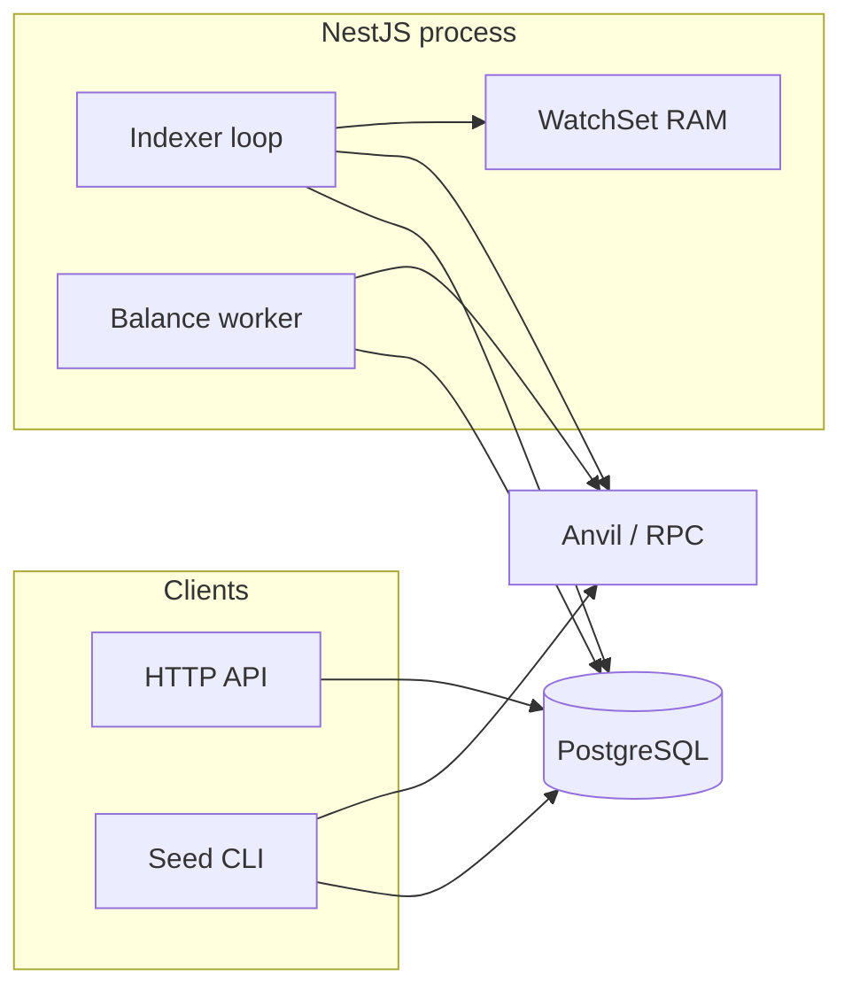
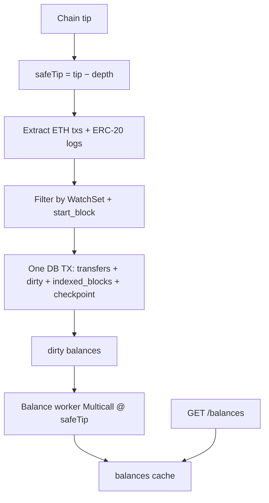

# EtherScope

NestJS service that watches many Ethereum addresses: indexes **native ETH** and configured **ERC-20** transfers, exposes history / balances / sync over HTTP, and recovers cleanly from restarts, RPC blips, and short reorgs.

Local demo: **Anvil + PostgreSQL** (Docker). Target scale for the seeder is **~100k** watched addresses with only a small active subset sending txs. No Redis/Kafka in v1.

## Quick start

```bash
cp .env.example .env
docker compose up -d
npm install
npm run migration:run
npm run start:dev
```

Then: [Swagger](http://localhost:3000/docs) · `GET /health` · `GET /metrics`

```bash
npm run seed -- --count=1000 --active-ratio=0.01
# scale demo: --count=100000 --active-ratio=0.001
```

Seed deploys mock tokens **ALP** / **BET**, funds a small active set, and writes sample transfers. CLI sets `ENABLE_INDEXER=false` so it does not fight the API for the DB lock.

Optional split processes: `npm run start:api` (HTTP only) and `npm run start:indexer`.

## API

| Method | Path | Notes |
|--------|------|--------|
| GET | `/health` | DB, RPC, indexer running, tip / last indexed |
| GET | `/metrics` | counters, lag, dirty queue, process roles |
| GET | `/addresses/:address/sync` | `startBlock`, checkpoint, tip |
| GET | `/addresses/:address/transfers` | `active` by default; `?includeReorged=true`; cursor pagination |
| GET | `/addresses/:address/balances` | cache-first; background worker fills dirty via Multicall3 (`ETH` or token address) |
| GET | `/admin/indexer` | running, WatchSet size, checkpoint |

`transfers.asset` is `eth` \| `erc20`; concrete ERC-20 is `tokenAddress` (see `tokens` table for ALP/BET).

## Architecture





**Decisions in v1**
- History in `transfers`; balances from chain (Multicall3), not naive deltas — gas / fee-on-transfer break sum-of-transfers.
- Index only to `safeTip`; keep `indexed_blocks` hashes; on mismatch soft-mark `reorged` and rewind checkpoint.
- Single writer via Postgres advisory lock; WatchSet in RAM for O(1) filter at ~100k addresses.
- Batch commit is atomic — crash mid-range replays from checkpoint (`orIgnore` on transfers).
- GET balances is cache-only; a capped worker (`BALANCE_REFRESH_*`) drains dirty rows so the API path does not stampede RPC.
- Transfers listing: two side queries (from / to) merged in memory so composite indexes stay usable (no SQL `OR`).
- Code layout: controller → service → repository; same binary can run as API-only or indexer via entrypoints.

**Growth path**
- API and indexer contend → split `start:api` / `start:indexer`
- WatchSet or hot shared state outgrows one box → **Redis** (shared set, rate limits, short locks)
- Ingest lag or dirty queue stays high → **Kafka** (or similar) between extract and persist; scale consumers
- Hot `transfers` reads → read replica, partition by time/block, or address-touch table
- Backups on a busy primary → replica / volume snapshot; keep statement timeouts

## Tests

Docker stack must be up. Prefer stopping `start:dev` first.

```bash
npm run test:e2e
npm run test:idempotency
npm run test:reorg
npm run format
npm run format:check
```
